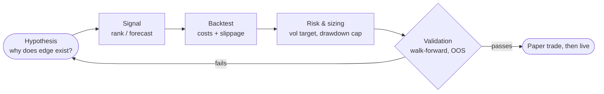

<div align="center">


<a href="https://github.com/dominickdupuy">
  
</a>

<br/>

[](https://domdupuy.com)
[](https://github.com/dominickdupuy)


</div>

---

## `>_` about

```python
class Dominick:
    school  = "University of Florida"        # CS + Statistics
    focus   = ["systematic trading", "alpha research", "backtesting", "risk"]
    method  = "state the edge, test it honestly, size for the drawdown"
    stack   = ["Python", "C++", "TypeScript", "Go"]

    def build_strategy(self, idea):
        hypothesis = self.explain_why_edge_exists(idea)
        signal     = self.forecast(hypothesis)
        results    = self.backtest(signal, costs=True, out_of_sample=True)
        return self.size_for_risk(results)
```

## `>_` research loop



Every strategy starts from a named source of edge (risk premium, behavioral bias, structural flow, or information), not from a curve fit.

## `>_` focus areas

<table>
  <tr>
    <td width="50%" valign="top">

**Alpha research**
Time-series momentum, mean reversion, regression and MLP forecasts on futures and equities.

**Backtesting infrastructure**
Engines for equities and options.

**Risk**
Volatility targeting, drawdown control, regime awareness.

  </td>
    <td width="50%" valign="top">

**Machine learning**
Neural nets from scratch, GNNs, time-series models (NHiTS, TFT, LSTM).

**Prediction markets**
Trading engine and competition tooling.

**Competitions**
Optiver quant competition submission, Gator Quant Hacks site.

  </td>
  </tr>
</table>

## `>_` selected projects

<table>
  <tr>
    <td width="50%" valign="top">
      <h3><a href="https://github.com/dominickdupuy/UK_GasFuturesStrategy">UK_GasFuturesStrategy</a></h3>
      UK MSI futures strategy using multilinear regression and an MLP, targeting <b>+2 Sharpe</b>.<br/><br/>
      
      
    </td>
    <td width="50%" valign="top">
      <h3><a href="https://github.com/dominickdupuy/options-ngin">options-ngin</a></h3>
      Options backtesting engine.<br/><br/>
      
      
    </td>
  </tr>
  <tr>
    <td width="50%" valign="top">
      <h3><a href="https://github.com/dominickdupuy/predict-ngin">predict-ngin</a></h3>
      Prediction market trading engine.<br/><br/>
      
      
    </td>
    <td width="50%" valign="top">
      <h3><a href="https://github.com/dominickdupuy/TradingClose">TradingClose</a></h3>
      Optiver quant competition submission.<br/><br/>
      
      
    </td>
  </tr>
  <tr>
    <td width="50%" valign="top">
      <h3><a href="https://github.com/dominickdupuy/WikiRaceGNN">WikiRaceGNN</a></h3>
      GraphSAGE GNN scaled to all ~7M Wikipedia pages, cutting node traversals by <b>~400%</b> vs conventional methods.<br/><br/>
      
      
    </td>
    <td width="50%" valign="top">
      <h3><a href="https://github.com/dominickdupuy/gatorqh">gatorqh</a></h3>
      Site for Gator Quant Hacks 2026, including the Systematic Trading track briefing.<br/><br/>
      
      
    </td>
  </tr>
</table>

<details>
<summary><b>More repositories</b></summary>
<br/>

| Project | What it is |
|---|---|
| [Systematic-Trading](https://github.com/dominickdupuy/Systematic-Trading) | Systematic strategy research in Python |
| [comp-backtest](https://github.com/dominickdupuy/comp-backtest) | Backtest harness for competition-style strategy evaluation |
| [SportsAnalysis](https://github.com/dominickdupuy/SportsAnalysis) | NBA prediction ensemble (NHiTS, TFT, LSTM, GNN) |
| [NeuralNetworkv2](https://github.com/dominickdupuy/NeuralNetworkv2) | From-scratch network with backpropagation and adaptive structure, applied to stock prices |
| [TradingBot](https://github.com/dominickdupuy/TradingBot) | Web app for researching financial data and market indicators |
| [Blockchain](https://github.com/dominickdupuy/Blockchain) | Cryptocurrency with a P2P network, written in Go |

</details>

## `>_` toolkit

<div align="center">


</div>

## `>_` github stats

<div align="center">


</div>

## `>_` principles

1. No edge without a reason it should exist.
2. Out-of-sample or it didn't happen.
3. Costs and slippage are part of the strategy, not an afterthought.
4. Size positions for the drawdown you can survive, not the return you want.


